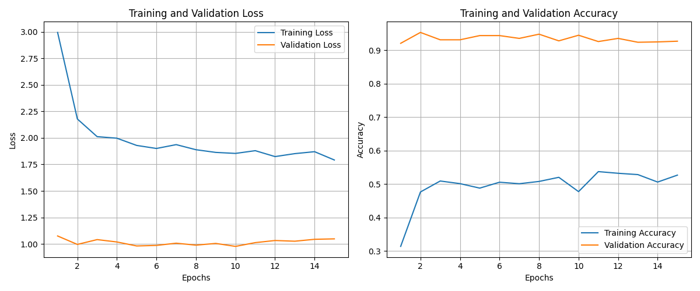
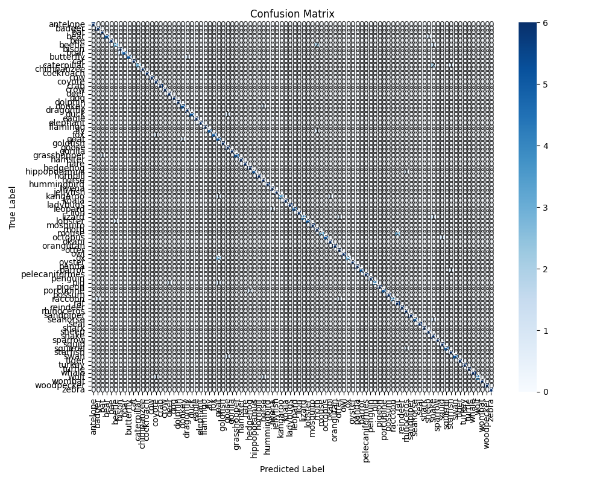

# MultiZoo Hayvan Tanıma Sistemi

Swin Transformer (`swin_base_patch4_window7_224`) tabanlı, 90 hayvan türünü sınıflandıran bir görüntü sınıflandırma projesi. PyTorch ve `timm` ile eğitildi; Gradio web arayüzü ve PyQt5 masaüstü arayüzü içerir.

## Sonuçlar (Test Seti, 540 görüntü)

| Metrik | Değer |
|---|---|
| Accuracy | %92,6 |
| Weighted Precision | %94,5 |
| Weighted Recall | %92,6 |
| Weighted F1 | %92,5 |

<p>
  
  
</p>

## Kullanılan Teknikler

- ImageNet ön-eğitimli Swin Transformer ile transfer learning
- Data augmentation (RandomResizedCrop, flip, color jitter, rotation)
- MixUp ve label smoothing
- AdamW optimizer, early stopping

## Proje Yapısı

```
src/
  config.py      # Tüm ayarlar (model, eğitim, yollar)
  dataset.py     # Veri yükleme
  preprocess.py  # Dönüşümler / augmentation
  model.py       # Model tanımı
  train.py       # Eğitim döngüsü
  evaluate.py    # Metrikler ve grafikler
  predict.py     # Tek görüntü tahmini
main.py          # Eğitim / değerlendirme giriş noktası
desktop_ui.py    # Gradio web arayüzü
app.py           # PyQt5 masaüstü arayüzü
results/         # Test metrikleri ve grafikler
```

## Kurulum

```bash
python -m venv venv
venv\Scripts\activate
pip install -r requirements.txt
```

Veri seti `data/MultiZoo/train` ve `data/MultiZoo/test` klasörlerine, her sınıf ayrı bir alt klasörde olacak şekilde yerleştirilmelidir.

## Kullanım

```bash
# Eğitim
python main.py --mode train

# Test setinde değerlendirme
python main.py --mode evaluate

# Web arayüzü (http://127.0.0.1:7860)
python desktop_ui.py

# Masaüstü arayüzü
python app.py
```

> Eğitilmiş model dosyaları (~1 GB) GitHub boyut sınırı nedeniyle depoya eklenmemiştir. Arayüzleri kullanmak için önce modeli eğitin; model `models/best_multizoo_model.pth` olarak kaydedilir.
